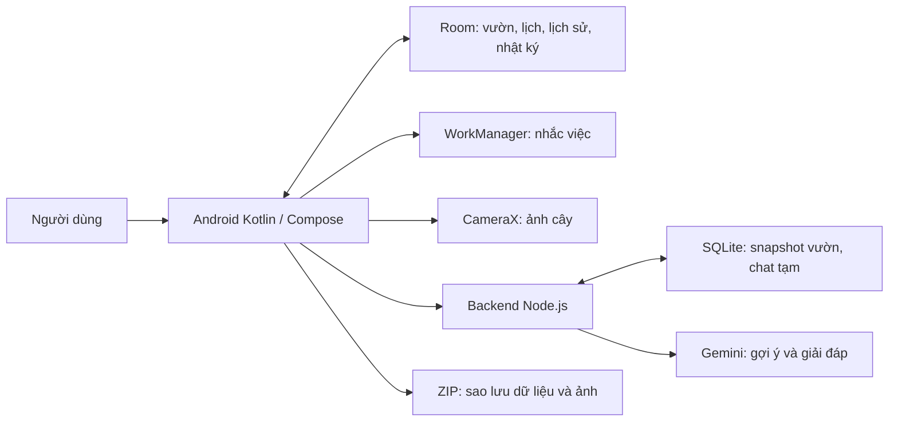

# Vườn Nhà — phạm vi báo cáo và kiểm chứng

Ngày rà soát: 14/10/2026. Tài liệu này mô tả bản mã nguồn hiện tại, thay cho mô tả giao diện cũ trong tài liệu ngày 10/10.

## Tên và mục tiêu phù hợp

**Ứng dụng quản lý và nhắc chăm sóc cây tại nhà, tích hợp trợ lý AI.**

Giúp người dùng tạo hồ sơ cây, ghi điều kiện trồng, lên lịch nhắc, ghi nhận việc đã làm và theo dõi phát triển bằng ảnh. AI hỗ trợ gợi ý loài từ ảnh, tra cứu tên cây và giải đáp dựa trên vườn đã lưu. Người dùng duyệt trước khi lưu hoặc áp dụng hướng dẫn.

Nhóm cá/thú cưng là chức năng mở rộng đã có trong mã; nên dùng cây cảnh làm phạm vi demo chính để nghiệp vụ nhất quán.

## Kiến trúc thực tế

**Room là dữ liệu gốc trên thiết bị.** Backend chỉ nhận snapshot được chọn khi người dùng gửi câu hỏi; không phải hệ thống đồng bộ tài khoản. API key Gemini chỉ nằm ở backend. Bản debug nối backend cục bộ bằng ADB reverse, không yêu cầu người dùng nhập key trong app.

## Dữ liệu và ý nghĩa

| Dữ liệu | Ý nghĩa |
|---|---|
| Item | Tên riêng, loài, khu vực, profileJson |
| Zone | Khu vực, trong/ngoài trời, mái che |
| CareTask | Tên việc, chu kỳ, mốc tính lịch, hoãn |
| CareLog | Việc thực sự được người dùng đánh dấu hoàn thành và thời điểm |
| DiaryEntry | Ghi chú/ảnh theo cây và thời điểm |
| Backend gardens | Snapshot tên cây, điều kiện trồng, kế hoạch, CareLog và múi giờ thiết bị theo bản cài |
| Backend messages | Hội thoại tạm, tối đa 48 giờ |

`lastDone` trong CareTask có thể là mốc khởi tạo lịch: không dùng nó làm bằng chứng người dùng đã tưới/bón. CareLog mới là lịch sử thực hiện. Vị trí nhập tay và khu vực đều là dữ liệu người dùng cung cấp, không phải đo bằng cảm biến.

## Các luồng chính để demo

1. Thêm cây bằng tên → chọn gợi ý/danh mục → chỉnh tên riêng, vị trí, ánh sáng, giá thể → đặt lịch → lưu.
2. Hoàn thành một việc → có CareLog → mở Chăm sóc → chọn đúng ngày → xem việc đã làm.
3. Ghi ảnh/ghi chú → chọn ngày hoặc mở hồ sơ cây → xem nhật ký và so sánh ảnh.
4. Quét/chọn ảnh → kết quả gợi ý → đọc thông tin → Tiếp theo → sửa biểu mẫu → lưu. Mất mạng có thể nhập thủ công.
5. Trợ lý: hỏi việc hôm nay/hôm qua đã làm → trả từ CareLog; hỏi kiến thức/chăm sóc sắp tới → Gemini nhận snapshot cần thiết.
6. Sao lưu ZIP → khôi phục trong môi trường thử → kiểm tra tên, lịch, hồ sơ và ảnh. Khôi phục thay dữ liệu hiện tại, phải có bản sao trước khi demo trên vườn thật.

## Sửa lỗi trong đợt rà soát này

- Phân biệt câu hỏi kế hoạch/tư vấn với lịch sử đã làm; lọc tên cây/loài nếu được nhắc trong câu hỏi.
- Ngày hôm nay/hôm qua của trợ lý dùng múi giờ thiết bị gửi lên, tránh lệch ngày với lịch trên app; không dựng lại bộ định dạng ngày cho từng log.
- Khi hỏi cả tưới và bón, không đưa mọi loại log vào câu trả lời; việc kiểm tra phân bón không được gọi là đã bón.
- Backend từ chối JSON lỗi và chu kỳ vượt 365 ngày bằng lỗi phù hợp.
- Giữ nháp thêm cây: tên, thông tin đã sửa/xoá, lịch và ngày khi Compose khôi phục trạng thái. Khôi phục trạng thái không phải tự lưu cây chưa bấm Lưu.
- Giữ bước camera/kết quả/biểu mẫu khi Activity được tạo lại trong lúc ViewModel còn giữ kết quả.
- Lưu hồ sơ và đổi chu kỳ trong một giao dịch; biểu mẫu sửa chỉ đóng sau thành công, lỗi giữ nội dung.
- Lấy snapshot các bảng trong một giao dịch khi xuất sao lưu.
- Chỉ xin quyền thông báo khi người dùng chọn Thông báo trong Cài đặt; không bật hộp xin quyền ngay khi mở app.
- Cập nhật README theo thanh điều hướng và nghiệp vụ hiện tại.

## Giới hạn phải trình bày trung thực

- **Chưa phát hành công khai:** thiếu backend HTTPS, tài khoản và cơ chế xác thực/quota cho môi trường nhiều người. Token debug dùng phát triển. Release chưa có endpoint mặc định.
- **AI là gợi ý:** chưa có bộ ảnh đối chứng để công bố tỷ lệ nhận diện chính xác. Các mức cao/vừa/thấp do AI gợi ý không phải xác suất đã hiệu chuẩn. Không khẳng định tương đương Google Lens hay nhận biết đúng cá thể cây cũ.
- **Chưa có tìm kiếm web có nguồn:** tên ngoài danh mục/hướng dẫn dùng Gemini. Không nói app đã tìm Internet và xác minh nội dung. Chưa bật dịch vụ tính phí hay Billing.
- **Không bảo đảm miễn phí vô hạn:** việc gọi API phụ thuộc quota tài khoản; khi hết quota app cần báo lỗi và cho nhập thủ công. Chưa có đo chi phí cho triển khai thật.
- **Nhắc giờ có thể trễ:** dùng WorkManager, chưa có đo dài hạn khi tối ưu pin/tắt máy/đổi múi giờ trên điện thoại thực.
- **Dữ liệu cục bộ:** chưa có đăng nhập, khôi phục đám mây hoặc đồng bộ đa thiết bị. Chat hết hạn 48 giờ nhưng snapshot vườn vẫn giữ đến khi thay thế/xoá. Khi backend dừng, dọn chat thực hiện lúc khởi động lại trước khi phục vụ lịch sử.
- **Chưa có:** cảm biến, tưới tự động, chẩn đoán bệnh đã kiểm chứng, huấn luyện mô hình riêng hay truy vấn bằng giọng nói.
- **Giả lập từng có ANR hệ thống:** không coi kiểm thử vượt qua sau đóng hộp thoại là chứng minh đã khắc phục mọi lỗi hệ thống Android.

## Việc cần bằng chứng thực tế trước buổi báo cáo

- Tập ảnh cây thật có tên đối chứng và ảnh không phải cây: ghi kết quả đúng/sai/chưa nhận diện, không bịa tỷ lệ.
- Một lần nhắc việc thực tế với app ở nền và quyền thông báo đã cấp.
- Một lượt demo mất mạng/quota: giữ nội dung và dùng thêm thủ công.
- Demo xuyên suốt tạo cây → chăm sóc → ngày trên lịch → hỏi trợ lý → sao lưu.

Hướng dẫn khởi động: [CHAY_APP.md](CHAY_APP.md). APK debug: `app/build/outputs/apk/debug/app-debug.apk`.
