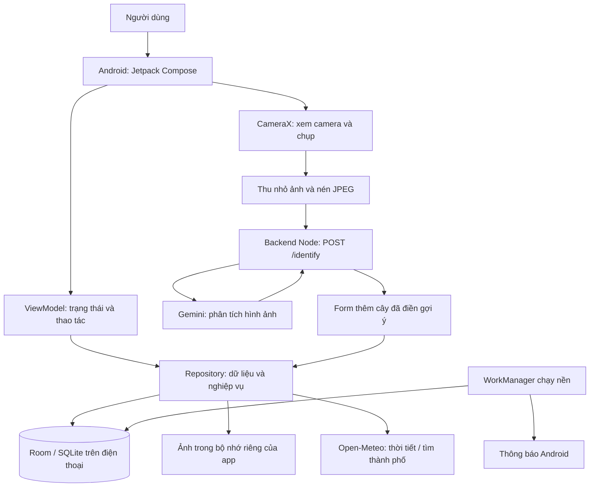

# Vườn Nhà — hệ thống và cách hoạt động

> Tài liệu lịch sử ngày 10/10. Bản mới có mục Chăm sóc và Trợ lý: xem [BAO_CAO_SAN_SANG.md](BAO_CAO_SAN_SANG.md), [REDESIGN_2026_10.md](REDESIGN_2026_10.md) và [CHAY_APP.md](CHAY_APP.md) trước khi dùng nội dung này trong báo cáo.

Tài liệu theo mã nguồn và kiểm tra ngày 10/10/2026. Bản hiện tại là ứng dụng Android lưu dữ liệu trên điện thoại, có backend riêng cho nhận diện ảnh. Chưa phải dịch vụ công khai với tài khoản và đồng bộ nhiều thiết bị.

## 1. Người dùng làm được gì?

| Mục | Công dụng |
|---|---|
| Vườn nhà | Xem cây/cá/thú cưng, tìm kiếm, thêm thủ công, sửa, xóa, phân khu vực, xem việc cần chăm sóc |
| Quét cây | Chụp ngay trong app hoặc chọn ảnh, nhận gợi ý loài, tự mở form thêm cây để duyệt |
| Lịch | Xem việc theo tuần/tháng, chọn ngày, mở đối tượng cần chăm sóc |
| Chi tiết | Thông tin từng cây, lịch riêng, hoàn thành/hoãn, lịch sử và mốc ảnh |
| Nhật ký | Ghi chú và ảnh, so sánh ảnh đầu–mới nhất, xem lịch sử chăm sóc |
| Tiện ích | Khu vực trong/ngoài nhà, thời tiết theo thành phố |
| Cài đặt | Giờ nhắc, thông báo thử, giao diện, ẩn/hiện quét, xuất/nhập sao lưu |

Không có loài trong danh sách vẫn nhập được tên loài hoặc mô tả tạm. Cây không rõ tên có thể lưu trước rồi chỉnh sau. Nhận diện AI hiện chỉ hỗ trợ cây; cá/thú cưng thêm thủ công.

## 2. Cấu trúc hệ thống



Android chịu trách nhiệm giao diện, dữ liệu cá nhân, lịch, nhắc nhở và ảnh nhật ký. Backend chỉ xử lý yêu cầu nhận diện; hiện không lưu hồ sơ vườn hoặc ảnh ra đĩa. Gemini là dịch vụ bên ngoài xử lý ảnh. App không chứa khóa Gemini và không gọi Google bằng khóa bí mật trực tiếp.

## 3. Dữ liệu lưu ở đâu?

| Thành phần | Dữ liệu |
|---|---|
| `Item` | ID, tên gọi, mã loài, khu vực |
| `Zone` | Tên khu vực, trong/ngoài trời, có mái che, biểu tượng |
| `CareTask` | Việc chăm sóc, chu kỳ ngày, mốc khởi tạo/lần làm gần nhất, ngày hoãn, loại việc |
| `CareLog` | Việc đã làm và thời điểm thực hiện |
| `DiaryEntry` | Ghi chú, thời điểm, đường dẫn ảnh |
| SharedPreferences | Giờ nhắc, giao diện, ẩn quét, thành phố và cache thời tiết |
| File riêng của app | Ảnh nhật ký đã nén |

Room hiện dùng schema v4, có migration từ các phiên bản cũ. Xóa đối tượng sẽ xóa các việc, lịch sử và nhật ký liên quan qua khóa ngoại; repository dọn ảnh. Dữ liệu chưa đồng bộ lên tài khoản. Gỡ app/xóa dữ liệu có thể mất vườn; xuất sao lưu trước khi đổi máy hoặc cài lại.

## 4. Thêm cây thủ công

**Cập nhật tra cứu bằng tên:** nhập tên và bấm Tra cứu thông tin cây. Backend đọc danh mục tham khảo (không dùng AI), app cho chọn kết quả rồi điền tên khoa học, chiều cao trưởng thành tham khảo, độ ẩm không khí, giá thể và ánh sáng. Giống và chiều cao thực tế là dữ liệu người dùng bổ sung. Có nguồn hiển thị, chỉnh sửa trước/sau lưu được, sao lưu giữ thông tin. Danh mục ban đầu chỉ ba loại: kim tiền, lan hồ điệp, trầu bà lá xẻ. Tên chưa có thì nhập tay. Database nâng lên v5 bằng migration giữ dữ liệu cũ, thêm Item.profileJson.

Vườn nhà → Thêm vào vườn → chọn nhóm → chọn loài có sẵn hoặc tự nhập → đặt tên gọi riêng → khu vực → việc và chu kỳ → mốc bắt đầu → lưu.

Tên loài và tên gọi khác nhau: “Kim tiền” là loài, “Kim tiền bàn học” là tên bạn đặt. Danh sách loài có lịch mẫu; người dùng chỉnh được vì đất, chậu, mùa và vị trí ảnh hưởng nhu cầu chăm sóc. Có thể thêm việc riêng hoặc lưu chưa có lịch.

Chỉ đóng form sau khi cơ sở dữ liệu lưu thành công. Nếu lỗi, giữ nội dung để thử lại; chặn bấm lưu liên tiếp.

## 5. Quét cây

1. Bấm Quét cây ở giữa thanh dưới. Lần đầu Android hỏi quyền camera.
2. Camera mở trực tiếp trong app. Đưa một cây vào khung, chụp rõ lá/thân/hoa. Có thể chọn ảnh từ thư viện nếu không cấp camera.
3. Bấm Nhận diện cây: chụp → thu nhỏ tối đa khoảng 1024 px → JPEG 80% → gửi ảnh đến backend.
4. Backend xác thực mã truy cập phát triển, kiểm tra kích thước/JPEG, giới hạn lượt và gọi Gemini. Không ghi ảnh/khóa vào log.
5. Gemini trả tối đa 3 gợi ý: tên, tên khoa học, đặc điểm nhìn thấy, mức chắc chắn định tính, hướng dẫn ngắn và việc chăm sóc tham khảo.
6. Backend kiểm tra cấu trúc kết quả rồi trả về app. Không có cây/không đủ thông tin có thể trả danh sách rỗng; không tạo loài giả để hoàn tất luồng.
7. App tự mở form Thêm vào vườn, điền gợi ý đầu tiên. Bạn đổi gợi ý, sửa tên/lịch hoặc Bỏ gợi ý, tự nhập.
8. Bấm lưu: cây, lịch và ảnh đầu tiên được ghi cùng giao dịch. Nếu thất bại, dữ liệu trong DB được rollback, ảnh chưa lưu được dọn.

Quét không tự lưu cây khi chưa xác nhận. “Độ chắc chắn” là tự đánh giá của mô hình, không phải xác suất khoa học. Không có chức năng chẩn đoán bệnh hoặc kết luận cây an toàn để ăn.

Nếu đã có mục cùng tên loài, app gợi ý mở mục cũ. Hai cây cùng loài có thể rất giống nhau; chưa có nhận diện cá thể. QR/mã cây phù hợp hơn nếu sau này muốn xác định đúng cây đã lưu.

## 6. Lịch chăm sóc và thông báo

Ngày đến hạn = ngày khởi tạo/làm gần nhất + chu kỳ; nếu hoãn thì lấy ngày muộn hơn. Tính theo ngày lịch ở múi giờ điện thoại, không cộng máy móc mỗi ngày 24 giờ.

- Hoàn thành: cập nhật mốc làm gần nhất, bỏ hoãn, ghi `CareLog`, tính lần nhắc sau.
- Hoãn: dời ngày đến hạn, không ghi là đã chăm sóc.
- Ngày khởi tạo chỉ đặt lịch, không tạo lịch sử hoàn thành giả.
- Các lần lặp tương lai trên lịch là dự kiến; việc quá hạn vẫn được báo cần chăm sóc.

WorkManager kiểm tra hằng ngày quanh giờ người dùng chọn (mặc định 07:00). Android có thể trì hoãn do pin/nền; đây chưa phải báo thức đúng từng phút. Android 13+ cần cấp quyền thông báo. Thông báo hiển thị tối đa ba việc và nút hoàn thành/hoãn chỉ tác động các việc được liệt kê. Có nút thông báo thử trong Cài đặt.

## 7. Nhật ký, ảnh và sao lưu

Ảnh nhật ký được thu nhỏ/nén, lưu riêng trong app; DB lưu đường dẫn. Form quét lưu ảnh làm mốc đầu tiên; sau đó thêm ảnh cùng cây để so sánh phát triển. Biểu đồ chăm sóc lấy dữ liệu từ các lần hoàn thành, không đo độ lớn thực của cây bằng cảm biến.

Sao lưu ZIP gồm `data.json` và `photos/*.jpg`. Nhập sao lưu THAY THẾ vườn hiện tại, không gộp; giao diện yêu cầu người dùng xác nhận. File JSON cũ vẫn nhập được nhưng không có ảnh.

Giới hạn nhập: JSON 10 MB, mỗi ảnh 20 MB, tổng giải nén 200 MB, tối đa 2000 mục trong ZIP. Tên file trong ZIP không được dùng làm đường dẫn đích. File không hợp lệ rollback DB và dọn ảnh mới, giữ dữ liệu/ảnh cũ. Giờ nhắc, giao diện và thành phố không nằm trong ZIP dữ liệu vườn.

## 8. Thời tiết

Người dùng tự tìm và chọn thành phố; không bắt buộc cấp vị trí. Chỉ khi chủ động dùng vị trí hiện tại mới cần quyền vị trí gần đúng. Open-Meteo trả dự báo 7 ngày; cache dùng lại khoảng 2 giờ, có thể hiển thị dữ liệu cũ khi mất mạng.

Gợi ý mưa/nắng nóng là tham khảo, đặc biệt cho khu vực ngoài trời. App không có cảm biến độ ẩm đất, pH hoặc nhiệt độ bể cá, và không tự thay đổi lịch chăm sóc theo dự báo.

## 9. Cách chạy trên máy bạn

### Android

1. Mở Android Studio → Open → chọn `D:\Hoc_Tap\VuonNha_1\VuonNha_1` (thư mục chứa `settings.gradle.kts`).
2. Đợi Gradle sync, chọn module `app` và thiết bị Pixel 6, bấm Run.
3. Máy ảo đang dùng Virtual Scene nên camera hiển thị cảnh mô phỏng. Để thử cây thật, Chọn ảnh hoặc dùng điện thoại/webcam.

### Backend, không cần Docker

**Thử điện thoại USB:** bản debug mới dùng `127.0.0.1:8787` qua ADB reverse. Cắm cáp, bật gỡ lỗi USB và chấp nhận máy tính; `run-backend.cmd` tự chạy script chuyển cổng trước khi mở backend. Nếu backend đã chạy, mở PowerShell tại backend và chạy `powershell -NoProfile -ExecutionPolicy Bypass -File .\connect-usb.ps1`. Cần tạo lại chuyển cổng sau khi rút/cắm hoặc khởi động lại thiết bị. Cả emulator cũng cần chuyển cổng này.

Node.js 22+ và `.env` đã cấu hình. Khóa chỉ ở `.env`; không chép khóa vào Android hay gửi lên Git.

1. Windows + E → mở `D:\Hoc_Tap\VuonNha_1\VuonNha_1\backend`.
2. Nhấp đúp `run-backend.cmd`, giữ cửa sổ mở trong khi thử quét. Nếu báo cổng đã dùng, backend khác có thể đang chạy; không mở thêm bản nữa.
3. Hoặc gõ `powershell` ở thanh địa chỉ thư mục, Enter, chạy:

```powershell
node --env-file=.env server.mjs
```

4. Mở PowerShell khác để kiểm tra:

```powershell
Invoke-RestMethod http://127.0.0.1:8787/health
```

`ready: true` chỉ là có cấu hình, không xác nhận khóa hợp lệ/quota. Bản debug emulator tự gọi `http://127.0.0.1:8787/identify`; người dùng không nhập URL/token. Tắt máy/đóng tiến trình backend thì lần sau cần chạy lại. Docker là phương án thay thế, không bắt buộc.

Để không phát sinh phí, dùng project Gemini không bật Billing và theo hạn mức tài khoản; tài liệu này không đảm bảo Google luôn cung cấp miễn phí hoặc hạn mức không thay đổi. Hết quota thì app báo thử lại, không tự chuyển dịch vụ trả phí.

## 10. API và phát hành

| API | Vai trò |
|---|---|
| `GET /health` | Kiểm tra backend có cấu hình |
| `POST /identify` | Nhận JSON `imageBase64` JPEG, header Bearer token, trả `candidates` |

Backend giới hạn request 2 MB, tối đa 10 lượt/phút cho tiến trình, một lượt xử lý cùng lúc; timeout gọi Gemini 45 giây. Đây là giới hạn thử nghiệm, chưa phải quota theo người dùng hay hệ thống chịu tải nhiều máy chủ.

Mã token debug trong APK không phải bảo mật cho phát hành. Bản release chưa có endpoint/xác thực đầy đủ. Muốn người khác tải app và quét ngay cần: backend HTTPS luôn chạy → tài khoản/phiên truy cập → hạn mức từng người → cấu hình endpoint khi build → kiểm thử thiết bị thật → ký APK/AAB. Khóa Gemini vẫn chỉ nằm máy chủ. Chưa thực hiện đăng ký/triển khai dịch vụ bên ngoài trong lượt này.

## 11. Phạm vi kiểm chứng

Xem `SYSTEM_STATUS.md` để biết kết quả build/test hiện tại. Kiểm thử giả lập kiểm tra xử lý và luồng, không chứng minh độ chính xác nhận diện. Cần ảnh cây thật và quyền/quota Gemini để đánh giá chất lượng. Nhắc nhở cần thử trên điện thoại qua nhiều ngày và khi tối ưu pin bật.

Phạm vi đồ án nên trình bày quanh cây cảnh: quản lý → chăm sóc → lịch sử phát triển, AI hỗ trợ nhập thông tin. Cá/thú cưng là phần mở rộng. Chưa có đồng bộ tài khoản, nhận diện cá thể, cảm biến hoặc mạng xã hội.

