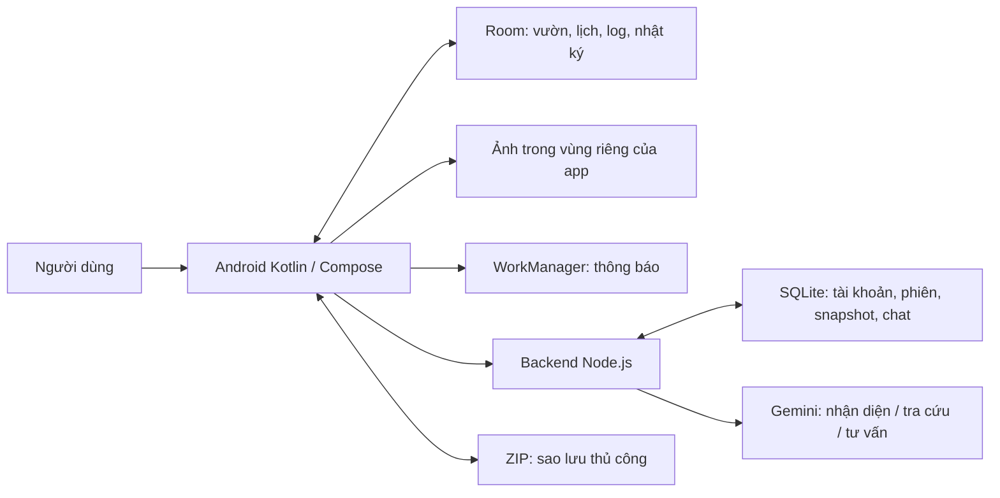

# Vườn Nhà

Ứng dụng Android quản lý và nhắc chăm sóc cây tại nhà, có trợ lý AI hỗ trợ tra cứu và giải đáp. **Tài liệu chính của đồ án — cập nhật 16/10/2026.**

Tài liệu này thay thế các báo cáo hiện trạng, thiết kế và hướng dẫn rời rạc trước đây. Khi sửa dự án, cập nhật đúng mục bên dưới; không tạo thêm Markdown theo từng lần sửa. Hướng dẫn cấu hình/API riêng nằm trong [backend/README.md](backend/README.md).

## 1. Tổng quan hướng tới

Đối tượng chính là người trồng cây tại nhà muốn biết mình có cây gì, đặt ở đâu, khi nào cần kiểm tra/chăm sóc và đã làm gì. Luồng trọng tâm: **thêm cây → đặt lịch → ghi nhận chăm sóc → xem lại theo ngày → hỏi trợ lý khi cần**.

Phạm vi báo cáo nên tập trung cây cảnh. Cá/thú cưng là nhóm mở rộng đã có trong mã, chưa có nghiệp vụ chuyên sâu tương đương cây. AI là hỗ trợ tùy chọn; người dùng kiểm tra gợi ý trước khi lưu. Không mô tả app là Google Lens, cảm biến đo cây hay hệ thống tưới tự động.

### Nhận xét tổng thể

- Nền tảng quản lý cục bộ đã khá đầy đủ cho một đồ án: hồ sơ, khu vực, lịch, lịch sử đã làm, ảnh/nhật ký và sao lưu.
- Luồng thêm cây hiện rõ hơn: ba bước ngắn và xem lại trước khi lưu; thông tin tham khảo có thể bỏ không lưu.
- Bốn tab có thiết kế thống nhất hơn, nhưng chưa có nghiên cứu người dùng để kết luận giao diện đã tối ưu. Cần thử với người mới, chữ lớn, bàn phím và TalkBack.
- Backend có xử lý thật cho tài khoản, tra cứu và trợ lý; không đồng nghĩa APK đã dùng độc lập ngoài máy tính.
- Đã có bản lưu vườn theo tài khoản, chưa phải đồng bộ hợp nhất nhiều thiết bị. Còn thiếu backend công khai HTTPS, sao lưu máy chủ độc lập và đánh giá nhận diện bằng bộ ảnh cây thật.
- Không kết luận “không còn lỗi” từ build hoặc một lượt test. Các bằng chứng và giới hạn được tách rõ ở mục 7–8.

### Điểm thiếu sót xác định khi đọc mã bản hiện tại

Rà soát 16/10: các điểm sau chưa được sửa trong lượt đánh giá này. Đây là đối chiếu đường xử lý trong mã, chưa tái hiện từng trường hợp trên điện thoại.

| Ưu tiên | Điểm cần sửa | Ví dụ / lý do |
|---|---|---|
| P0 về tính đúng hồ sơ | Đổi loài chưa làm mất hiệu lực gợi ý cũ | Sau khi tra cứu Kim tiền rồi sửa tên thành Cây táo, onValueChange giữ profile và lịch gợi ý. Đổi lựa chọn danh mục cũng chưa đối chiếu profile với loài mới. Cần theo dõi nguồn gợi ý, tách lịch tự nhập và đề nghị duyệt lại khi đổi loài. |
| P1 về kiểm tra nhập liệu | Vẫn kiểm tra trường bổ sung đã chọn không lưu | valid/canContinue đang kiểm tra toàn bộ profile, còn loại trường chỉ diễn ra khi submit. Một mô tả >1000 ký tự có thể chặn lưu dù đã bỏ lưu thông tin bổ sung. Cần kiểm tra đúng dữ liệu sẽ ghi. |
| P1 về tính nhất quán | Điền thông tin chưa đồng đều giữa hai cách chọn cây | Ô bổ sung/nút điền gợi ý nằm trong nhánh tự nhập cây; chọn loài từ danh sách có lịch mẫu nhưng chưa có cùng bộ ô tra cứu. Không mô tả tất cả loài đều có đầy đủ thông tin điền sẵn. |
| P1 về chịu lỗi | Một số thao tác cập nhật chưa có báo lỗi riêng | Thêm/sửa hồ sơ có bắt lỗi, nhưng các launch xóa cây, hoàn thành/hoãn, thêm khu vực trong PlantsViewModel chưa có xử lý lỗi tương đương. Chưa thử lỗi lưu trữ/DB ở các thao tác này. |

Ưu tiên sửa tính đúng dữ liệu và hồi quy trước khi thêm tính năng. Bộ test đang đạt chưa bao phủ các tình huống trên.

## 2. Chức năng hiện có

| Phần | Hành vi thực tế |
|---|---|
| Vườn Nhà | Số thành viên/việc đến hạn/lượt đã chăm hôm nay lấy từ dữ liệu thật; thêm, sửa, xóa, tìm kiếm, lọc và phân khu vực. |
| Thêm cây | Chọn cây → Góc trồng → Nhắc chăm → Xem lại → Xác nhận lưu. Tra cứu bằng tên là tùy chọn. |
| Thông tin bổ sung | Các ô mở sẵn khi có kết quả tra cứu/nhận diện. Khi tự nhập, có Điền gợi ý theo tên cây: một kết quả thì điền, nhiều kết quả cần chọn. Cho sửa và chọn lưu kèm; giữ trường đã sửa/xóa. Giống/chiều cao thực tế chưa biết để trống. |
| Chăm sóc | Lịch tuần/tháng; chọn ngày xem việc dự kiến, việc đã làm và ghi chú/ảnh. Hoàn thành hoặc hoãn cập nhật ngày nhắc. |
| Hồ sơ và nhật ký | Xem từng cây, lịch riêng, ghi chú/ảnh, mốc thời gian và so sánh ảnh. |
| Trợ lý | Hỏi lịch sử dựa trên CareLog; tư vấn khác dùng Gemini với snapshot vườn chọn lọc. Chat tối đa 48 giờ. |
| Tài khoản | Đăng ký/đăng nhập/đăng xuất, lưu và lấy lại vườn gồm ảnh/nhật ký; đăng nhập tùy chọn. Vừa đăng nhập không tự thay vườn trên máy. |
| Quét cây | Camera/chọn ảnh → gợi ý loài → đọc kết quả → điền biểu mẫu → duyệt lưu. Đang tạm ngừng cải tiến theo yêu cầu; không bảo đảm nhận mọi cây. |
| Cài đặt | Giao diện, giờ nhắc, quyền thông báo, bật/ẩn quét, xuất/nhập sao lưu. |
| Tiện ích | Khu vực trồng, thời tiết; quét hiện trong menu Tiện ích khi được bật. |

Thanh điều hướng luôn có **Vườn Nhà · Chăm sóc · Trợ lý · Cài đặt**. Biểu tượng nhà/mầm cây, lịch/bình tưới, robot trò chuyện và bánh răng; mục được chọn có vạch nhấn phía trên. Không chạy HTML/WebView; mẫu người dùng gửi được chuyển sang Compose. Tiêu đề dùng serif hệ thống, chưa nhúng Playfair Display/Plus Jakarta Sans.

## 3. Luồng và quy tắc dữ liệu

### Thêm cây và kiểm tra nhập liệu

1. Nhập tên loài/mô tả hoặc chọn danh mục. Tra cứu chỉ chạy khi bấm nút: backend tìm danh mục trước, không có mới dùng Gemini.
2. Chọn gợi ý để điền hồ sơ. Không ghi đè trường người dùng đã sửa/xóa; giữ lịch đang nhập, chỉ thêm lịch gợi ý nếu lịch còn trống.
3. Đặt tên riêng/vị trí/điều kiện nơi trồng. Các mục này tùy chọn; để trống tên riêng sẽ dùng tên loài.
4. Lịch chăm cây gom mỗi việc vào một thẻ: tên việc, chu kỳ và ngày. Có thể chọn Chưa cần nhắc, đặt lịch sau để bỏ lịch. Nếu thêm lịch thì phải có tên việc, chu kỳ hợp lệ và ngày hợp lệ.
5. Bấm thêm mở **Xem lại trước khi lưu**; **Chỉnh lại** giữ nháp, **Xác nhận lưu** mới ghi Room. Lỗi lưu giữ nội dung để thử lại.
6. Bỏ chọn thông tin bổ sung sẽ không lưu nhóm thông tin tham khảo; vị trí, điều kiện nơi trồng và lịch vẫn giữ.

Tên loài/mô tả bắt buộc, tối đa 120 ký tự; tên riêng tối đa 120; mô tả tối đa 1000 ký tự/trường; tối đa 30 việc/cây, chu kỳ 1–365 ngày. Tên thiếu/quá dài không cho sang bước tiếp; chỉ rõ lỗi. Ngày chăm gần nhất không được ở tương lai. Các giới hạn cơ bản đã có, chưa phải xác minh khoa học mọi nội dung (ví dụ độ ẩm hoặc chiều cao do người dùng nhập).

Quay lại từng bước và khôi phục trạng thái màn hình giữ nháp trong phạm vi đã kiểm thử. Nháp không phải hồ sơ đã lưu; không hứa giữ sau mọi tình huống gỡ app/xóa dữ liệu.

### Lịch, nhật ký và thông báo

- CareTask lưu chu kỳ/mốc lập lịch; **CareLog mới là bằng chứng người dùng đánh dấu đã làm**. Mốc khởi tạo không tự tạo log.
- Hoàn thành cập nhật lịch và ghi log trong giao dịch; hoãn chỉ đổi ngày nhắc, không tạo lịch sử đã chăm.
- Ngày tương lai là dự kiến, thay đổi khi hoàn thành/hoãn. Tính theo ngày lịch và múi giờ thiết bị.
- WorkManager nhắc quanh giờ đã chọn; Android có thể trì hoãn do pin/nền. Android 13+ cần quyền thông báo. Chưa phải báo thức chính xác từng phút.

### Quét và trợ lý

- Ảnh quét được nén JPEG, gửi backend rồi Gemini; backend không lưu ảnh quét ra đĩa. Khi xác nhận cây, ảnh có thể trở thành mốc nhật ký đầu tiên cùng giao dịch.
- AI trả gợi ý, có thể nhầm/không có kết quả. “Cao/vừa/thấp” không phải xác suất đã hiệu chuẩn. Mất mạng/quota vẫn có đường nhập thủ công.
- Khi gửi câu hỏi, app lấy snapshot nhất quán từ Room: tên/loài, điều kiện trồng, khu vực, lịch và log kèm múi giờ; không gửi ảnh/ghi chú nhật ký.
- Hỏi lịch sử dùng log thật trong các dạng câu hỏi được hỗ trợ; tư vấn khác dùng Gemini. AI không tự sửa vườn/lịch và chưa phải tìm kiếm web có nguồn.
- Tin nhắn hết hạn tối đa 48 giờ. Snapshot không hết hạn theo chat; có thể xóa dữ liệu Trợ lý. Xóa phía Trợ lý không xóa vườn Room; hỏi tiếp sẽ gửi snapshot mới.

## 4. Kiến trúc và nơi lưu



| Nơi lưu | Nội dung |
|---|---|
| Android Room | Item, Zone, CareTask, CareLog, DiaryEntry; là dữ liệu gốc của vườn. |
| Vùng file của app | Ảnh nhật ký; gỡ app/xóa dữ liệu có thể mất ảnh và vườn. |
| Android preferences | Tùy chọn; phiên tài khoản mã hóa AES-GCM bằng Android Keystore, không lưu mật khẩu. |
| backend/data/accounts.sqlite | Tài khoản, mật khẩu băm scrypt + salt, hash phiên tối đa 7 ngày và ZIP vườn mới nhất theo tài khoản. |
| backend/data/garden.sqlite | Snapshot chọn lọc và chat; tách theo khóa bản cài hoặc tài khoản đã xác thực. |
| backend/.env | Khóa Gemini và cấu hình riêng máy, bị Git bỏ qua. Không đưa khóa vào APK/tài liệu. |

Đăng nhập tách Trợ lý và bản lưu vườn theo tài khoản. Room vẫn là vườn đang mở trên thiết bị, không tự đổi khi đăng nhập/đăng xuất. Chưa có Google/Facebook login, xác minh email, quên mật khẩu hoặc hợp nhất thay đổi nhiều thiết bị.

### Tài khoản và lấy lại dữ liệu

- Đăng ký gồm tên hiển thị, tên đăng nhập, mật khẩu và xác nhận. Backend băm mật khẩu bằng scrypt + salt, không lưu dạng đọc được; không yêu cầu người dùng nhập hash.
- Đăng ký thành công thì app thử lưu vườn hiện có. Nếu tải bản lưu thất bại, tài khoản vẫn có nhưng phải báo chưa lưu được dữ liệu.
- Có Lưu vườn hiện tại, Lấy lại vườn đã lưu, Kiểm tra lại và Dừng tự lưu. Ghi đè bản máy chủ/khôi phục thay vườn đều có xác nhận.
- Sau lưu/khôi phục thành công, gắn tự lưu với tài khoản trên thiết bị này. Khi app đang mở, thay đổi được gom khoảng 2,5 giây rồi tải ZIP; lỗi mạng thử lại khoảng 30 giây khi luồng còn hoạt động. Chưa bảo đảm tự lưu sau khi app bị đóng/diệt tiến trình.
- Tối đa 25 MB gồm cây, khu vực, lịch, log, ghi chú và ảnh. Quá dung lượng báo lỗi và giữ bản máy chủ cũ; vẫn có thể xuất ZIP cục bộ.
- Mỗi tài khoản giữ một bản mới nhất. Kiểm tra số phiên bản trước khi ghi; xung đột từ thiết bị khác dừng tự lưu và cần người dùng lựa chọn, không âm thầm ghi đè.
- Khôi phục kiểm tra SHA-256, dùng bộ nhập có transaction. Trước thay thế giữ ZIP dự phòng nội bộ ở filesDir/garden-before-account-restore.zip. Nên xuất thêm ZIP riêng nếu cần giữ vườn hiện tại.
- Đăng xuất không xóa vườn/bản máy chủ. Đăng nhập tài khoản khác không tự ghi đè hoặc tải vườn; phải chọn lưu hoặc khôi phục.
- SQLite hiện trên máy tính chạy backend. Máy tính/database hỏng vẫn có thể mất bản lưu: cần hosting độc lập và sao lưu máy chủ trước khi cam kết bảo vệ dữ liệu khi mất thiết bị.

Sao lưu ZIP gồm dữ liệu vườn và ảnh, không chứa mật khẩu/phiên tài khoản. Khôi phục **thay thế** vườn hiện tại; không gộp. Kiểm tra giới hạn, khóa ngoại, giao dịch và dọn ảnh mới khi lỗi. Giới hạn nhập: JSON 10 MB, ảnh 20 MB/ảnh, tổng giải nén 200 MB/2000 mục. Sao lưu trước khi demo khôi phục trên vườn thật.

## 5. Chạy dự án

Thư mục mở bằng Android Studio: `D:\Hoc_Tap\VuonNha_1\VuonNha_1` (có settings.gradle.kts).

- Android tối thiểu API 26; compile/target SDK 37 theo cấu hình hiện tại.
- Gradle wrapper và daemon toolchain JDK 25 được khai báo trong dự án. Dùng môi trường Android Studio đã cấu hình; lần đầu có thể cần tải SDK/toolchain.
- Node.js 24+ cho backend; Docker là tùy chọn, không bắt buộc.

1. Mở dự án, chờ Gradle Sync.
2. Chỉ chạy một giả lập (Pixel 6 hoặc Pixel_6_Audit) hoặc cắm điện thoại đã bật USB debugging và cho phép máy tính.
3. Nếu dùng API/tài khoản, mở `backend/run-backend.cmd` và giữ chạy. Script dùng .env có sẵn và tạo ADB reverse cho thiết bị. Thiết lập lần đầu xem [hướng dẫn backend](backend/README.md).
4. Chọn đúng thiết bị trên Android Studio rồi Run module app. Note9 không phải Pixel 6; chọn đúng thiết bị vật lý khi muốn thử camera thật.
5. Sau rút/cắm cáp hoặc khởi động giả lập, chạy lại `backend/connect-usb.ps1` nếu cần. Không mở thêm server khi cổng 8787 đã có server chạy.

Kiểm tra kết nối khi lỗi:

```powershell
& 'C:\Users\DELL\AppData\Local\Android\Sdk\platform-tools\adb.exe' devices
# Thay SERIAL bằng ID có trạng thái device; unauthorized cần cho phép trên điện thoại.
& 'C:\Users\DELL\AppData\Local\Android\Sdk\platform-tools\adb.exe' -s SERIAL reverse tcp:8787 tcp:8787
Invoke-RestMethod http://127.0.0.1:8787/health
```

Health ready chỉ chứng minh có cấu hình, không chứng minh khóa/quota Gemini hợp lệ. Thiết bị offline là vấn đề kết nối ADB, không tự kết luận lỗi mã app. Nhập tiếng Việt trên giả lập nên bật Vietnamese/Telex trong Gboard; bộ gõ Windows qua bàn phím máy tính có thể không truyền dấu đúng.

APK debug: `app/build/outputs/apk/debug/app-debug.apk`. Cài cập nhật bằng `adb install -r` giữ dữ liệu; không gỡ app để cập nhật thông thường.

## 6. Bản đồ mã nguồn

| Vị trí | Trách nhiệm |
|---|---|
| app/src/main/java/com/example/vuonnha/ui/nav/AppNav.kt | Bốn tab, kiểu thanh điều hướng, chuyển màn hình. |
| ui/plants/PlantsScreen.kt | Trang chủ, thêm/sửa cây, kiểm tra và xem lại trước lưu. |
| ui/plants/PlantScanScreen.kt | Camera và luồng quét. |
| ui/plants/PlantRecognitionResult.kt | Kết quả gợi ý trước biểu mẫu. |
| ui/reminders/CareCalendarScreen.kt | Lịch và thông tin theo ngày. |
| ui/journal/JournalScreen.kt | Ghi chú/ảnh và nhật ký. |
| ui/settings/SettingsScreen.kt, AccountScreen.kt | Cài đặt và tài khoản. |
| ui/theme, ui/common, res/drawable/nav_*.xml | Màu, chữ, thành phần chung và biểu tượng tab. |
| data, domain, notify | Room/repository, tính lịch, thông báo. |
| app/src/test, app/src/androidTest | Kiểm thử nghiệp vụ và kiểm thử trên thiết bị. |
| backend/server.mjs, accounts.mjs, assistant.mjs | HTTP, tài khoản và trợ lý. |
| backend/plant-catalog.mjs, plant-lookup.mjs | Danh mục tra cứu và gợi ý ngoài danh mục. |

Các đường dẫn ui/data/domain/notify trong bảng tính từ `app/src/main/java/com/example/vuonnha/`.

## 7. Kiểm thử và bằng chứng

```powershell
./gradlew.bat testDebugUnitTest assembleDebug assembleDebugAndroidTest lintDebug
# Nếu dependency đã tải đủ có thể thêm --offline.
```

Backend (không gọi Gemini thật):

```powershell
cd backend
node --test --test-isolation=none
```

Thiết bị/giả lập (sau cài APK chính và APK androidTest):

```powershell
adb -s SERIAL shell am instrument -w -e class com.example.vuonnha.GardenNavigationTest com.example.vuonnha.test/androidx.test.runner.AndroidJUnitRunner
adb -s SERIAL shell am instrument -w -e class com.example.vuonnha.PlantScanFormTest,com.example.vuonnha.EditablePlantProfileTest,com.example.vuonnha.RecognitionFlowTest com.example.vuonnha.test/androidx.test.runner.AndroidJUnitRunner
```

Kết quả đã ghi nhận, không cộng dồn các lần chạy lặp thành số test mới:

| Bằng chứng | Phạm vi và giới hạn |
|---|---|
| Backend 37/37 đạt, chạy lại 16/10 | Thêm ZIP tài khoản, cách ly bản lưu, phiên bản chống ghi đè và SQLite qua restart; không đo độ chính xác AI. |
| JVM 23/23 đạt, chạy lại 16/10 | Tính lịch, chu kỳ, sao lưu và loài tự nhập; 0 failure, 0 error trong báo cáo XML. |
| Android 13/13 đạt, chạy lại sau đổi ô điền sẵn và thẻ lịch 16/10 | Nhập sai, lịch thiếu tên, xem trước/hủy/xác nhận, bỏ thông tin bổ sung vẫn giữ vị trí, sửa/xóa gợi ý và khôi phục nháp. Chưa kiểm thử riêng nút điền một kết quả qua mạng trong lượt này. |
| Điều hướng 3/3 đạt 16/10 | Bốn tab, vào lịch rồi về vườn nhiều lần, tài khoản tùy chọn; bản tab/biểu tượng mới đã được xem trên giả lập. |
| Tài khoản + sao lưu Android 2/2 đạt 16/10 | Server thử 8788: đăng ký/đăng xuất/sai mật khẩu/đăng nhập; ZIP khứ hồi có ảnh và log, tự lưu thay đổi, tách tài khoản. Không thay vườn người dùng. |
| Lint bản tài khoản/sao lưu | 0 lỗi, 29 cảnh báo. Sau đó sửa trạng thái lỗi/đang lưu, quyền riêng tư và dừng tự lưu; bản cuối build và chạy lại 2 kiểm thử tài khoản/sao lưu đạt, chưa chạy lint lại các thay đổi cuối. |
| Kiểm tra API thật 15/10 | Trợ lý, ảnh hoa lan, ảnh trắng và tra cứu cây táo đã có kết quả; chỉ xác nhận đường truyền với mẫu thử, không phải benchmark nhận diện. |
| Nhắc việc thực tế trước đó | Đã thử ngắn hạn khi Activity ở nền; chưa kiểm tra qua đêm/Doze trên nhiều hãng. |

Trước đây từng có ANR của Vườn Nhà khi chuyển camera/biểu mẫu và ANR của SystemUI/Google trên giả lập. Đã sửa đường đo layout, xử lý bàn phím và đóng camera trước biểu mẫu; các lượt hồi quy được ghi nhận đạt. Chưa chứng minh hết mọi ANR. Nếu tái diễn cần lấy Logcat/trace mới, không quy ngay cho RAM hoặc backend.

Kiểm thử API/thông báo/tài khoản opt-in cần môi trường riêng, không chạy tràn vào vườn người dùng. AccountFlowTest dùng server tạm cổng 8788 và namespace thử; test live có thể tiêu thụ quota. Kiểm tra file test trước khi bật. Ảnh QA chỉ giữ đủ để xem rồi xóa; không xóa ảnh nhật ký hoặc dữ liệu AVD.

## 8. Phần cần bổ sung — theo ưu tiên

| Ưu tiên | Việc cần làm | Điều kiện coi là xong |
|---|---|---|
| P0 trước báo cáo | Demo xuyên suốt trên thiết bị thật | Tạo cây → xem lại → lưu → hoàn thành việc → lịch đúng ngày → hỏi Trợ lý → xuất ZIP; có cả trường hợp hủy và lỗi. |
| P0 trước báo cáo | Hồi quy form và khả năng tiếp cận bản cuối | Người mới hiểu cách thêm; bàn phím/chữ lớn không che nút, lỗi đưa đúng trường, không ANR qua nhiều lượt. Chưa tuyên bố đã đủ TalkBack/WCAG. |
| P0 trước báo cáo | Đánh giá quét khi tiếp tục phát triển | Bộ ảnh cây thật có nhãn và ảnh không phải cây; ghi đúng/sai/chưa nhận diện, không dựng tỷ lệ. Hiện tạm ngừng phần quét. |
| P1 | Nhắc việc dài hạn | Thử qua đêm, khóa màn hình, tối ưu pin và đổi quyền trên điện thoại; ghi độ trễ. |
| P1 nếu cần đa thiết bị | Hoàn thiện dữ liệu tài khoản | Đã có bản lưu/khôi phục và kiểm tra phiên bản. Còn hợp nhất thay đổi, quyền sở hữu vườn khách, tự lưu nền, xuất bản ZIP dự phòng nội bộ, xóa tài khoản/bản lưu và quên mật khẩu. |
| P1 trước phát hành | Backend công khai và bảo vệ API | Hosting HTTPS, xác thực toàn bộ API, quota từng người, chống lạm dụng, khôi phục tài khoản, quản lý bí mật và vận hành. Không dùng token debug chung. |
| P2 | Nội dung chăm sóc đáng tin | Mở rộng danh mục có nguồn; phân biệt độ ẩm không khí/đất, thực đo/tham khảo; kiểm tra định dạng và giá trị trường sâu hơn. |
| P2 | Hoàn thiện hình thức | Đánh giá màn có nhiều cây và chữ dài; cân nhắc bộ phông có dấu đầy đủ, icon launcher và khoảng cách nhất quán. |

Không mở rộng cảm biến, tự động tưới, chẩn đoán bệnh hoặc chăm sóc gia đình trước khi ổn định luồng chính. Chưa tự bật Billing, không bảo đảm API miễn phí vô hạn.

## 9. Quy tắc giữ dự án gọn

- Giữ README này cho mục tiêu, luồng, hiện trạng, ưu tiên và kết quả xác minh mới nhất; sửa nội dung tại chỗ, không nối nhật ký sửa đổi lặp vô hạn.
- Giữ backend/README.md cho thiết lập, API, bảo mật vận hành. Không nhân bản hiện trạng sang nhiều file.
- Giữ app/, backend/, gradle/, Gradle wrapper, cấu hình và các test hồi quy. Test không chạy trong APK người dùng.
- Không xóa .env, backend/data, ảnh nhật ký, khóa ký hoặc dữ liệu thiết bị. Không xóa cache SDK/Gradle/AVD như một cách dọn tài liệu.
- .audit, ảnh chụp QA và log thử là tạm; xóa file được xác định, tránh xóa log của tiến trình đang chạy. Thư mục build có thể tái tạo nhưng không cần xóa mỗi lượt vì sẽ làm build lại tốn thời gian.

Đợt gom tài liệu 16/10 đã giảm 13 Markdown xuống 2, loại 11 báo cáo/hướng dẫn trùng hoặc lỗi thời sau khi tổng hợp, và dọn 18 ảnh QA cũ ở thư mục làm việc bên ngoài checkout. Giữ trace ANR làm bằng chứng chẩn đoán và log tiến trình; không xóa dữ liệu người dùng hoặc mã nguồn chỉ vì chưa dùng trong demo.

Nguồn thiết kế đã tham khảo: [Material navigation bar](https://m3.material.io/components/navigation-bar/overview), [NN/g progressive disclosure](https://www.nngroup.com/articles/progressive-disclosure/), [NN/g form cognitive load](https://www.nngroup.com/articles/4-principles-reduce-cognitive-load/). Bố cục và biểu tượng mới nhất dựa trên mẫu người dùng gửi; đã bỏ hướng Tammi.
