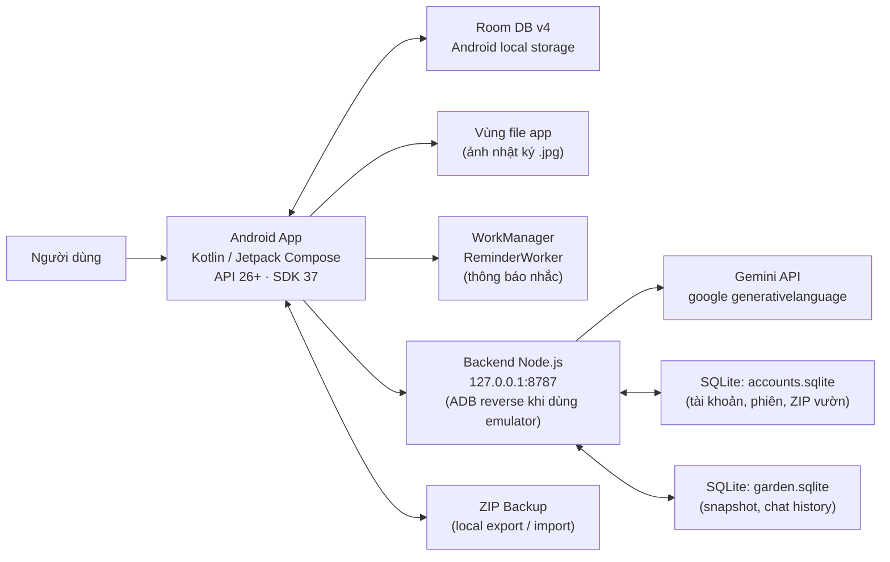
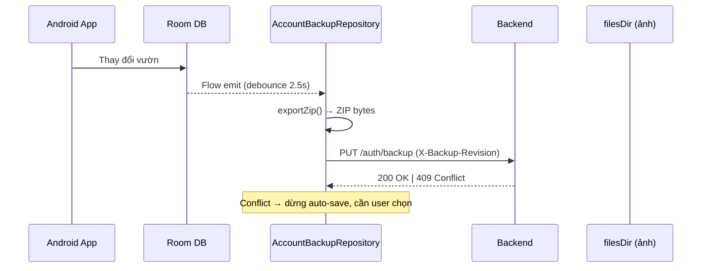
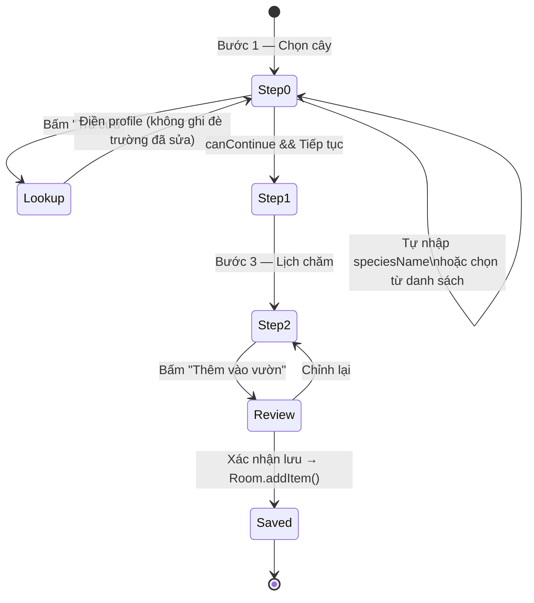

# ARCHITECTURE.md — Kiến trúc VuonNha_1

Tài liệu kỹ thuật mô tả cấu trúc thực tế của project.
Cập nhật lần đầu: 21/10/2026 · Antigravity (dựa trên đọc mã nguồn)

---

## 1. Tổng quan hệ thống



**Nguyên tắc:** Android Room là source of truth cho dữ liệu vườn. Backend chỉ phục vụ AI, tài khoản và backup—không phải primary storage.

---

## 2. Android App

### 2.1 Cấu hình build

| Thông số | Giá trị |
|---|---|
| `applicationId` | `com.example.vuonnha` |
| `minSdk` | 26 (Android 8.0) |
| `compileSdk` / `targetSdk` | 37 |
| AGP | 9.3.3 |
| Kotlin | 2.2.10 |
| Compose BOM | 2026.02.01 |
| Room | 2.8.4 |
| Navigation Compose | 2.9.8 |
| WorkManager | 2.11.2 |
| CameraX | 1.6.2 |
| KSP | 2.3.8 |

Build token phát triển (`build.gradle.kts`):
- `SCAN_ENDPOINT = "http://127.0.0.1:8787/identify"` (debug only)
- `SCAN_TOKEN = "vuonnha-local-2026"` (debug only, **bukan** Gemini key)
- Release: endpoint từ `gradle.properties`, token rỗng

### 2.2 Database Room (v4)

Vị trí: `data/AppDb.kt`, `data/Entities.kt`, `data/CareDao.kt`

```
Item (v1)
  ├── id: Long PK
  ├── name: String
  ├── speciesId: String  ← ID loài: "monstera", "custom:PLANT:Kim tiền", v.v.
  ├── zoneId: Long? FK → Zone (v2)
  └── profileJson: String (v2, default='')

Zone (v3)
  ├── id: Long PK
  ├── name, emoji: String
  ├── outdoor: Boolean
  └── covered: Boolean (v3)

CareTask (v1+)
  ├── id: Long PK
  ├── itemId: Long FK→Item CASCADE DELETE
  ├── name, everyDays, lastDone, snoozeUntil: standard
  └── type: String (v4, default='OTHER')  ← TaskType enum

CareLog (v1)
  ├── id: Long PK
  ├── itemId: Long FK→Item CASCADE DELETE
  ├── task: String, at: Long

DiaryEntry (v1)
  ├── id: Long PK
  ├── itemId: Long FK→Item CASCADE DELETE
  ├── at: Long, note: String, photoUri: String
```

> **Quan trọng:** Schema v4 đang là phiên bản cuối. Không thêm column hay entity mà không viết Room migration kèm test.

### 2.3 Domain layer

Vị trí: `domain/Schedule.kt`, `domain/CareCalendar.kt`

- `Schedule.kt`: `daysLeft()`, `dueAt()`, `completed()`, `snoozed()`, `scheduleStart()`, `dayOf()`, `occurrences()` — tính toán lịch thuần túy, không phụ thuộc Android
- `CareCalendar.kt`: `occurrences()` cho calendar view — trả `List<CalendarOccurrence>` với flag `projected`

Timezone: tính theo múi giờ thiết bị, dùng `LocalDate` + `ZoneId.systemDefault()`. Test có coverage cho DST (America/New_York).

### 2.4 UI — Navigation

Vị trí: `ui/nav/AppNav.kt`

4 tab cố định (NavigationBar Material3 custom):
```
Vườn Nhà  →  nav_garden.xml (drawable)
Chăm sóc  →  nav_care.xml
Trợ lý    →  nav_assistant.xml
Cài đặt   →  Settings icon (Material)
```

Navigation Compose với `NavHost`. Route phụ: `ItemDetail/{itemId}`, `PlantScan`, `Weather`, `Account`.

### 2.5 UI — Screens

| Screen | File | ViewModel |
|---|---|---|
| Vườn Nhà (home) | `PlantsScreen.kt` | `PlantsViewModel` |
| Thêm cây (AddSheet) | `PlantsScreen.kt` (inline) | — (state trong Composable) |
| Sửa cây (EditSheet) | `PlantsScreen.kt` (inline) | `PlantsViewModel.saveEdit()` |
| Chi tiết cây | `ItemDetailScreen.kt` | — |
| Quét camera | `PlantScanScreen.kt` | `PlantScanViewModel` |
| Kết quả nhận diện | `PlantRecognitionResult.kt` | — |
| Chăm sóc (lịch) | `CareCalendarScreen.kt` | `RemindersViewModel` |
| Nhắc nhở list | `RemindersScreen.kt` | `RemindersViewModel` |
| Nhật ký | `JournalScreen.kt` | `JournalViewModel` |
| Trợ lý | `AssistantScreen.kt` | `AssistantViewModel` |
| Cài đặt | `SettingsScreen.kt` | `SettingsViewModel` |
| Tài khoản | `AccountScreen.kt` | — (dùng AccountRepository trực tiếp) |
| Thời tiết | `WeatherScreen.kt` | `WeatherViewModel` |

### 2.6 Data repositories

| Repository | Trách nhiệm |
|---|---|
| `CareRepository` | CRUD Item/Zone/Task/Log/DiaryEntry, exportZip, importBackup |
| `AccountRepository` | Đăng ký/đăng nhập/đăng xuất, session AES-GCM qua Android Keystore |
| `AccountBackupRepository` | Lưu/lấy lại ZIP vườn theo tài khoản, tự lưu ~2.5s debounce |
| `PlantLookupRepository` | Tra cứu cây qua backend `/plants?q=...` |
| `PlantScanRepository` | Gửi ảnh JPEG base64 đến `/identify` |
| `AssistantRepository` | POST/GET/DELETE `/assistant`, snapshot vườn |
| `WeatherRepository` | Thời tiết (hiện chưa rõ nguồn) |

### 2.7 Notifications

Vị trí: `notify/ReminderWorker.kt`, `notify/ReminderActionReceiver.kt`

- WorkManager PeriodicWorkRequest, nhắc quanh giờ đã cấu hình trong Settings
- Android 13+: cần `POST_NOTIFICATIONS` permission
- Chưa phải báo thức chính xác; Android có thể trì hoãn do Doze/Battery Saver

---

## 3. Backend Node.js

### 3.1 Cấu hình

| Thông số | Giá trị |
|---|---|
| Runtime | Node.js ≥ 24 |
| Cổng | 8787 (localhost only) |
| Module system | ESM (`type: "module"`) |
| Test runner | `node --test` (built-in, không cần Jest) |

Không có `node_modules` — chỉ dùng built-in Node.js modules. Cấu hình từ `.env` (không commit).

### 3.2 Modules

```
server.mjs          HTTP server chính, validate/recognize scan
accounts.mjs        Account store, auth handler (register/login/logout/backup)
assistant.mjs       Garden store, assistant handler (chat + snapshot)
plant-catalog.mjs   Danh mục nội bộ + tìm kiếm
plant-lookup.mjs    Lookup online qua Gemini, validateProfiles
provider-fetch.mjs  HTTP fetch wrapper với error mapping
gemini-config.mjs   Generation config cho từng model
```

### 3.3 SQLite files (backend/data/)

| File | Nội dung |
|---|---|
| `accounts.sqlite` | Tài khoản, mật khẩu bcrypt/scrypt+salt, phiên (max 7 ngày), ZIP vườn mới nhất |
| `garden.sqlite` | Snapshot garden + chat history theo namespace (app install key hoặc account) |

> **Không commit `backend/data/`** — đã có trong `.gitignore`. Chứa dữ liệu người dùng thật.

### 3.4 Security model

- Gemini API key: chỉ trong `.env`, không bao giờ đưa vào APK hay log
- `SCAN_TOKEN` debug: `vuonnha-local-2026` — token local, không phải Gemini key
- Phiên tài khoản: hash lưu trong SQLite, không lưu raw token
- Android Keystore: mã hóa AES-GCM cho session preferences trên thiết bị
- Backup ZIP: kiểm tra SHA-256 khi khôi phục; phiên bản chống ghi đè (409 khi conflict)

---

## 4. Backup & Data Flow



---

## 5. Luồng thêm cây (AddSheet)



**State quan trọng trong AddSheet:**
- `manualPlans`: lịch người dùng tự nhập — **không reset khi đổi loài**
- `suggestedPlans(key=sp.id)`: lịch gợi ý theo loài — reset khi chọn loài khác từ danh sách
- `profile`: map field → value — chỉ reset khi đổi SpeciesGroup
- `editedFields`: set key đã người dùng sửa — lookup không ghi đè
- `keepExtra`: có lưu referenceKeys không

---

## 6. Phụ lục: Loài và Species ID

| Loại | ID format | Ví dụ |
|---|---|---|
| Built-in | Chuỗi ngắn | `"monstera"`, `"sen"`, `"betta"` |
| Custom (người dùng tự nhập) | `"custom:{GROUP}:{name}"` | `"custom:PLANT:Kim tiền"` |

`findSpecies(id)` xử lý cả hai loại. Backup ZIP lưu `speciesId` nguyên văn — đảm bảo custom species tái tạo được khi restore.
